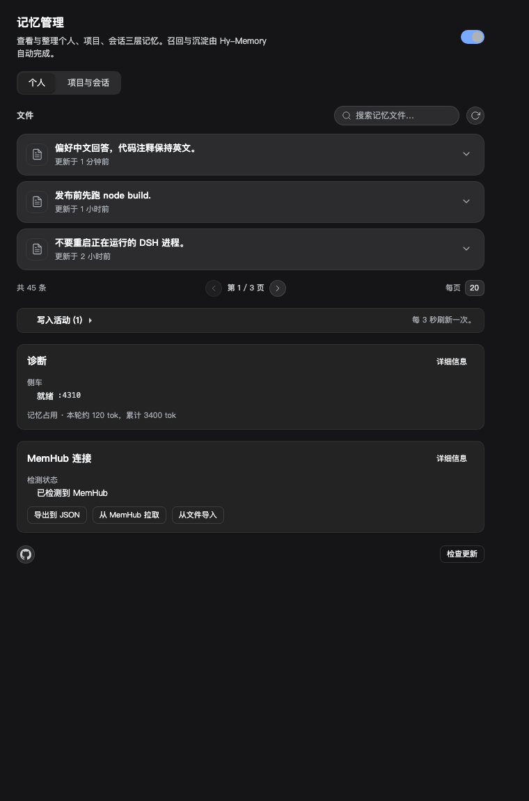
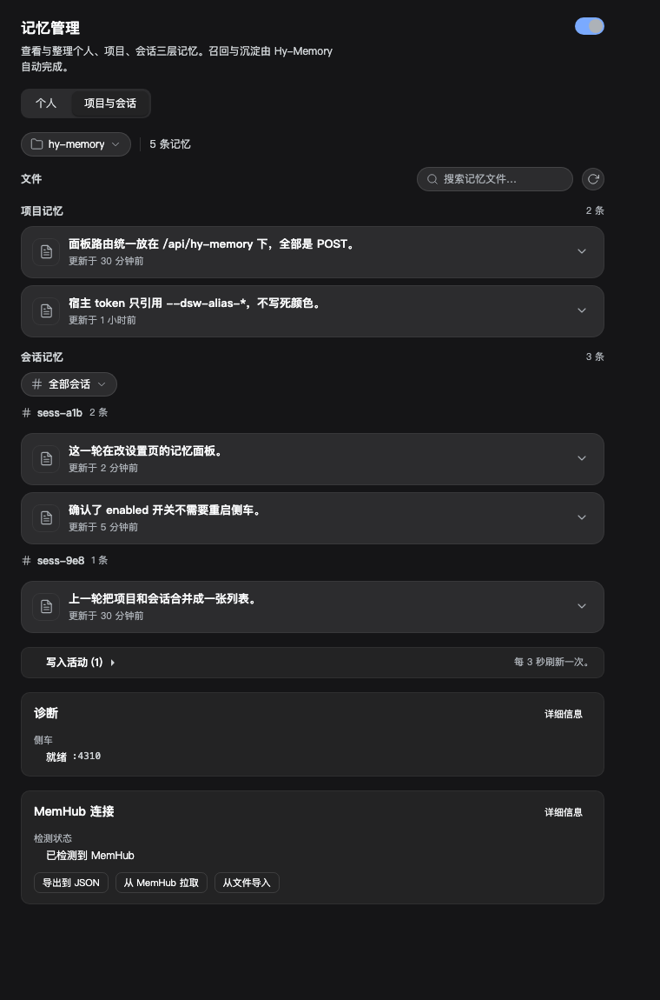
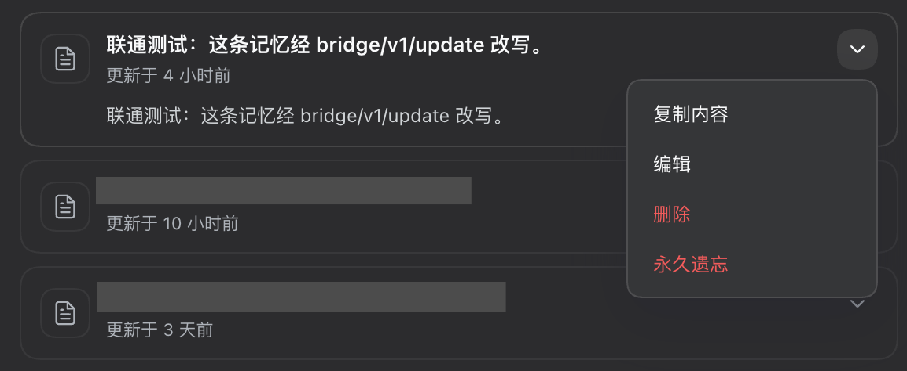
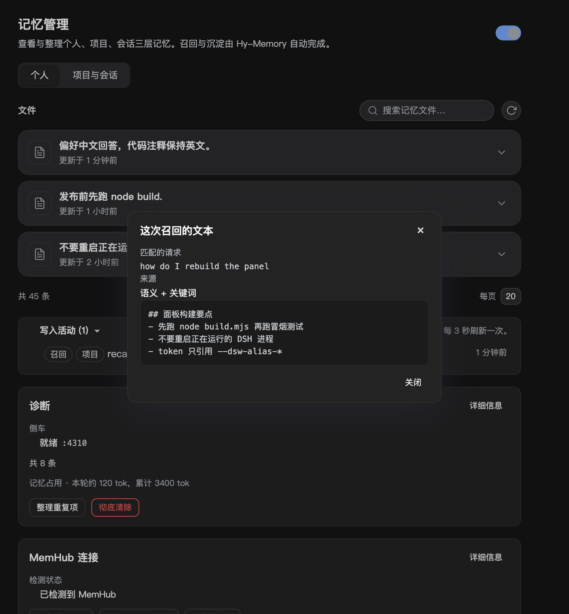
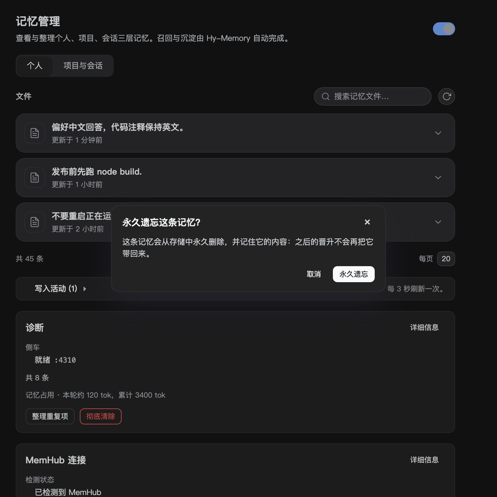
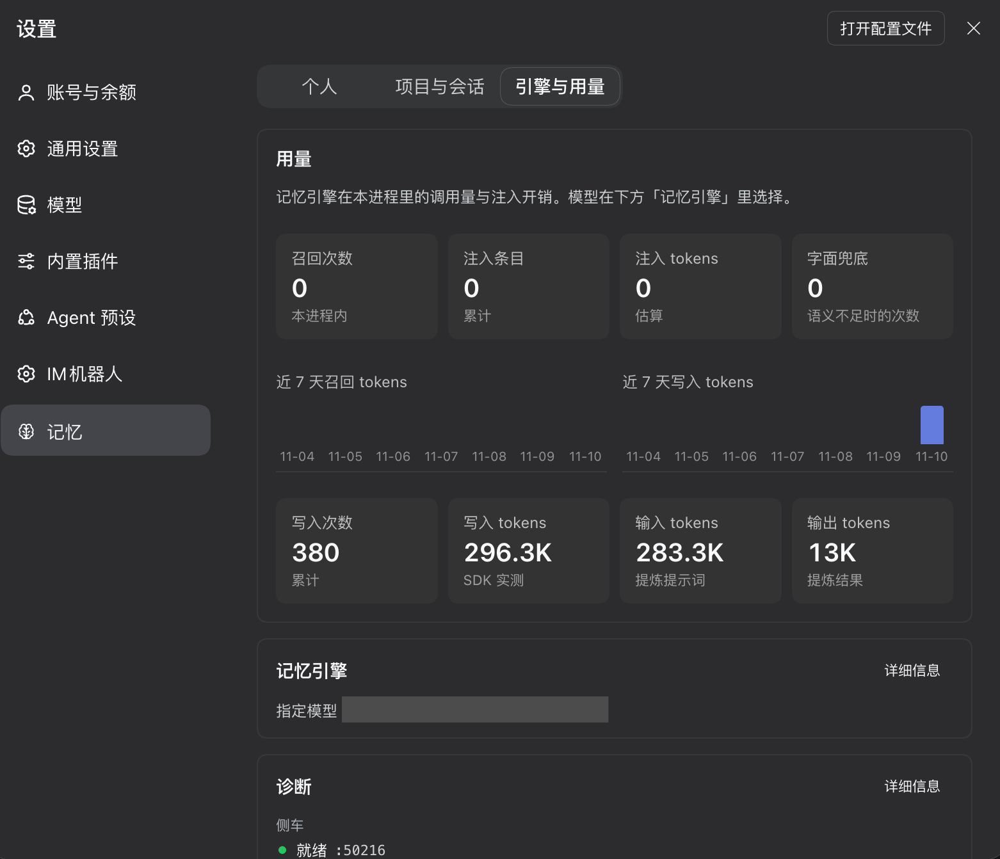

# dsh-hy-memory

[中文](README.md) | English

[](https://www.npmjs.com/package/dsh-hy-memory)
[](LICENSE)
[](https://dshfind.com/zh/plugins/Echo-Smith/dsh-hy-memory?ref=badge)
[](https://awesome-dsh-plugin.com/zh/p/Echo-Smith/dsh-hy-memory/)


> Three tiers of long-term memory for DSH. Open a new session and it still knows your preferences, this project's conventions, and the mistakes you already paid for — without you repeating any of it.



```bash
node scripts/install-into-profile.mjs --spec dsh-hy-memory --apply
```

Restart or reload DSH, then open **Settings → Memory**.

---

## The problem it solves

DSH has no long-term memory. `AGENTS.md` is a static file you write by hand; conversation history lives and dies with the session. Change sessions, or open a subagent, and you re-explain the conventions, the preferences, the traps — and you have to explain them as clearly as the first time.

A hand-written `AGENTS.md` covers part of it, but only if you notice something is worth recording, and remember to go edit it. In practice you don't.

dsh-hy-memory hands that to the plugin: it captures while the conversation runs, recalls when the next turn needs it, and lets you review, edit and delete anything from a panel.

**What changes once it is installed**: in a brand-new session, the first turn already knows what you said before — without you mentioning it.

## How the three tiers divide the work

| Tier | What it holds | Who can see it |
|---|---|---|
| **Session** | Details of this conversation, tool calls, temporary conclusions | This session only |
| **Project** | This repository's conventions, paths, commands, decisions | Every session in the workspace |
| **Personal** | Preferences, working style and standing rules across projects | Every project |

Distillation only flows one way: **session → project → personal**. Conventions that keep recurring in a session are distilled into project memory; preferences repeatedly confirmed at the project level are promoted to personal. Never the reverse — a one-off debugging detail cannot pollute the personal tier.



## Install

### From npm (recommended)

Published as [`dsh-hy-memory`](https://www.npmjs.com/package/dsh-hy-memory). The profile needs two things: the package as a dependency, and its name in `dsh.profile.bundles`. The script does both and verifies the installed entry actually exports `apply()`:

```bash
node scripts/install-into-profile.mjs --spec dsh-hy-memory --apply
```

By hand that is `pnpm add dsh-hy-memory` in the profile plus the name in `dsh.profile.bundles`.

### From source

```bash
dsh plugin --profile desktop add link:$(pwd)
```

### From GitHub Packages

A scoped build is published as `@echo-smith/dsh-hy-memory`. Reading it needs a token with `read:packages`:

```bash
# ~/.npmrc
# @echo-smith:registry=https://npm.pkg.github.com
# //npm.pkg.github.com/:_authToken=${GITHUB_TOKEN}
node scripts/install-into-profile.mjs --spec @echo-smith/dsh-hy-memory --apply
```

Or install straight from a GitHub Release (the dependency becomes a tarball URL):

```bash
node scripts/install-into-profile.mjs --spec https://github.com/Echo-Smith/dsh-hy-memory/releases/download/v0.1.6/dsh-hy-memory-0.1.6.tgz --apply
```

### Dependencies

- DSH 0.2.x (verified on 0.2.2-rc.1)
- An OpenAI-compatible model route; memory reuses whatever you already configured in DSH, no extra key
- Python 3.11+: a private venv is prepared on first start, nothing is installed into your system Python. With [uv](https://docs.astral.sh/uv/) installed, uv fetches and pins Python 3.12 itself; without uv it falls back to whatever 3.11+ you already have

## What you will use

### The panel

Settings → Memory. Two tabs (personal, project & sessions), each with search, paging, and per-row expansion, editing and deletion. Personal memories can be edited and forgotten for good; project and session tiers are read-only, so hand edits never fight automatic capture.

| | |
|---|---|
|  | **"Why was this recalled"** |
| Every row expands to details and deletion | Open any memory to see which retrieval brought it in: the query, how many matched, and each score. Screenshot pending. |

| | |
|---|---|
|  |  |
| The exact text the model received | Forgetting asks twice and records a hash so promotion cannot resurrect it |

### Personal-tier writes by judgement

The personal tier is shared by every project, so automatic promotion fills it slowly and conservatively. To keep it from going stale, each session receives one short standing policy asking the model to call `memory_add` with `tier: "personal"` when it recognises a durable preference, working style, or standing rule — without waiting to be asked. It is injected once per session, only together with a working recall, and lists what must *not* be stored (one-off details, secrets, anything obvious from the repository).

Turn it off with `recall.personalWrites: false`.

### What cross-session recall looks like

Recalled content arrives as a **source-attributed** user message that states plainly: this is background, it may be stale, it is not an instruction. It never impersonates your words and never overrides your current request.

### Updating from the panel

When the check finds a newer release, the footer offers an update button. It downloads that release's tarball, verifies its package name and version, and installs it into this profile with the profile's own package manager (pnpm from the DSH app when the profile has a lockfile). It refuses any version other than the one the check just reported, and refuses downgrades.

It does **not** restart DSH. A plugin runs inside the app's main process and cannot relaunch it, and a restart would drop every live session — so the panel reports the version now on disk and asks you to restart, which is the same contract DSH's own plugin manager uses.

### Plugin market index

DSH's plugin detail page compares the installed package with a market index and flags updates itself. This repository ships `market/index.json` (format 1, validated with DSH's own parser). Add this URL under the plugin market settings:

```
https://raw.githubusercontent.com/Echo-Smith/dsh-hy-memory/main/market/index.json
```

## Configuration

Settings → Memory → Diagnostics / Memory engine. `settings.json` works too.

| Key | Default | Meaning |
|---|---|---|
| `enabled` | on | Master switch |
| `mode` | `pro` | `lite` stores raw text without calling a model |
| `tiers.personal` / `project` / `session` | all on | A disabled tier is neither searched nor written |
| `recall.maxItems` | 5 | Most memories injected per turn |
| `recall.maxChars` | 1200 | Character budget for injected text; each item is also capped so one long memory cannot take it all |
| `recall.minScore` | 0.45 | Relevance floor; lower recalls more, and more noise |
| `recall.halfLifeDays` | 30 | Recency half-life; equal relevance favours the newer memory |
| `recall.personalWrites` | on | Whether the "write to personal" policy is injected |
| `capture.windowTurns` | 3 | Turns buffered before a model pass |
| `capture.idleFlushMs` | 180000 | Force a capture after this much idle time |
| `capture.includeToolCalls` | on | Capture tool calls as well |
| `capture.toolResultChars` | 1200 | Truncation length per tool output |
| `capture.productivity` | off | Route batches to the working/coding stores |
| `capture.concurrency` | 3 | Parallel writes |
| `capture.maxPerDrain` | 8 | Items handled per drain |
| `capture.maxAttempts` | 20 | Retries before the raw text is demoted to the lite layer |
| `promotion.everyTurns` | 8 | Turns between promotions |
| `promotion.onSessionEnd` | on | Catch up promotion when a session ends |
| `embedding.mode` | `local` | `local` ONNX or `remote` embeddings |
| `sidecar.idleStopMs` | 1800000 | Stop the sidecar after this much idle time |
| `lifecycle.maxPerTier` | 2000 | Per-tier capacity; the oldest are archived beyond it |
| `llm.*` | follow DSH | Model for memory work; empty follows the current session |



## Troubleshooting

**Nothing happens after installing, or the panel will not open**
Check the sidecar state under Settings → Memory → Diagnostics. The first start installs Python dependencies; give it a minute. If it shows an error, restart DSH once.

**Memories are written but nothing relevant is recalled**
`recall.minScore` defaults to 0.45; lower it to recall more (and noisier). Recall also needs a turn that completes normally — if a turn cannot read memory, the write policy is skipped with it.

**No new memories for a long time**
Automatic promotion counts turns within a single session, so parallel sessions each fall short. Just ask the assistant to remember something, or let it write to the personal tier directly.

**Make it forget something**
Forget it row by row in the panel. Forgetting records a content hash so promotion cannot write it back.

**Does it read things it should not?**
Credentials are filtered before a batch reaches the capture queue and never reach memory. Recalled content is labelled as background material and is not executed as instructions.

## Privacy and data location

Everything lives under `$DSH_HOME/integrations/hy-memory/`: SQLite, the vector store, logs and a private Python environment. Apart from calls to the model endpoint you configured, the plugin sends nothing anywhere.

**Erasing everything**: the Diagnostics card has an "Erase all data" button. It removes the whole directory including the Python environment (usually a few hundred MB), and requires typing `ERASE` plus seeing the measured size before it will run. DSH, your conversations and other plugins are untouched.

Removing only the plugin keeps your memories: the data stays in place and is there again on reinstall.

---
---

## Design notes (for maintainers)

### How it works

The plugin runs inside DSH. The memory core is the Hy-Memory 2.0 Python SDK behind a sidecar process with its own venv, so there is no separate service to run.

- **Recall** — on `agent/pre-step`, searches three routes (personal, current project, current session) and injects one source-attributed user message.
- **Capture** — listens to session events, buffers a window, hands conversation plus tool calls to the sidecar, and writes to the chat / working / coding stores by scene.
- **Promotion** — session memories are distilled into project conventions, project conventions into personal preferences.
- **Storage** — all under `$DSH_HOME/integrations/hy-memory/`, reusing your DSH model route; local ONNX embeddings by default.

### Why was this recalled

Every recall is traceable: expand any memory in the panel to see which query brought it in, which retrieval, and the exact text injected at the time. When debugging "why does it remember this" or "why did it forget that", this is the only reliable evidence.

### Engine settings and write health

The Memory engine card exposes the model and the budgets: `maxTokens`, `timeoutMs`, `halfLifeDays`, `concurrency`, `maxPerDrain`, `maxAttempts`. The model can follow the DSH default or be pinned.

Repeated sidecar failures surface the error code and streak length in Diagnostics, suggesting a model change.

### Concurrency and retries

Capture defaults to 3 parallel writes (`capture.concurrency`), 8 per drain (`maxPerDrain`), and 20 retries (`maxAttempts`) before the raw text is demoted to the lite layer.

The queue lives in its own file, `capture-queue.json`, with a single owner; the state file has a write lease so overlapping instances during a reload cannot clobber each other.

### Forgetting and recency

- Ranking is relevance × recency, 30-day half-life by default.
- Forgetting records a content hash so promotion cannot write the memory back.
- Exceeding `lifecycle.maxPerTier` archives rather than deletes.

### Capacity

2000 rows per tier by default; the oldest batch is archived beyond that.

### State that must survive a restart

Two failures shared one cause and are now separated:

- The Python venv marker used to be written into `state.json`, so rebuilding the environment erased the project index, capture cursors and promotions. The marker lives in `venv.json` now.
- A host reload can overlap two instances; the state file keeps a single writer, and a read-only instance takes the lease over once the holder exits.
- The project index is also written to `projects.json`, which the panel reads directly, and rebuilt at boot from the memory store and the session directory names.

Memory rows themselves were never affected: they live in the SDK store.

### Agent teams

Subagents and the lead share the project tier but keep separate session tiers. A lead recall does not absorb unrelated sibling sessions; a subagent can see the lead's memories.

### Compatibility and limits

- DSH 0.2.x; the plugin reports host interface changes in Diagnostics instead of degrading silently.
- Working/coding stores are only visible to a search that carries a workspace id.
- `[search-coding] fact layer empty` is SDK observability: the coding fact layer is empty for that workspace and the query fell back to experiences. It is not a failed write.
- A generic preference ("the user prefers Chinese answers") scores high on every query and can still crowd out a specific fact when slots are scarce; literal-overlap weighting only mitigates part of that.

### Verifying a change

```bash
node --test test/*.test.mjs        # host logic
node test/panel-smoke.mjs          # panel rendering
node scripts/check-client-id.mjs   # the bundle's loader id must equal the package name
```

`npm run check:id` runs in CI; `scripts/deploy-local.mjs` installs a local build into the current profile, rebuilding with the installed package name and verifying before copying.

### MemHub pairing

If MemHub is installed, both stores interoperate: "Export to JSON", "Pull from MemHub", "Import from file". Sync itself is controlled from the MemHub panel; this plugin only wires it up.

### Cold start

The sidecar warms up when the plugin starts, so the first recall does not pay for it. If it is not running, recall waits at most `waitForStartMs` before skipping the turn rather than blocking the conversation.

### Duplicates

The panel groups identical memories so you can keep one and delete the rest; each group shows its content and count before you decide.

## Contributing

Issues and PRs are welcome.

- Behaviour changes need tests: `node --test test/*.test.mjs`
- Panel changes need `node test/panel-smoke.mjs`
- Run `node scripts/check-client-id.mjs` before pushing — the bundle's loader id must equal the package name, and that is the easiest trap to fall into

## License

MIT
