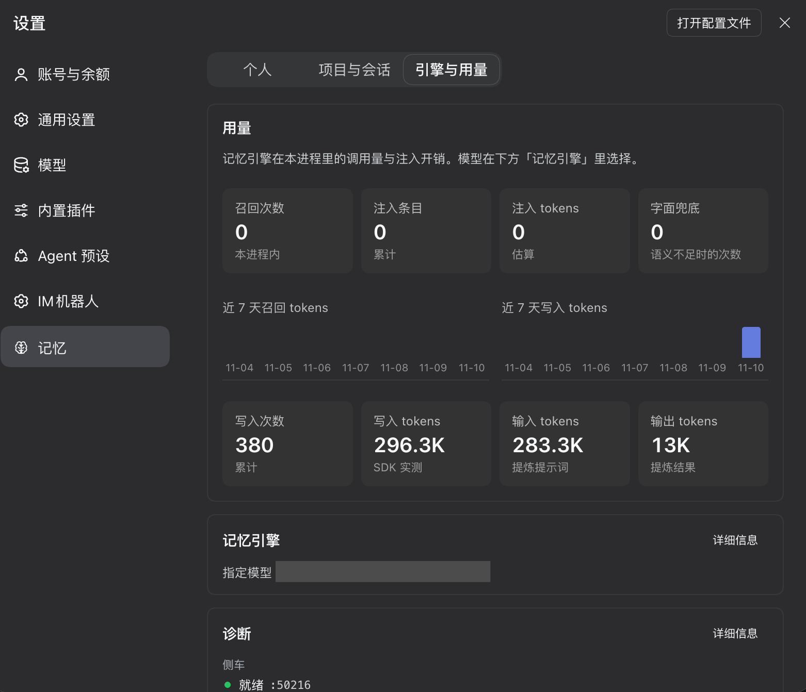

# dsh-hy-memory

[English](README.en.md) | 中文

> 给 DSH 装上三层长期记忆。新开一个会话，它仍然记得你的偏好、这个项目的约定，以及上次踩过的坑——不用你重讲一遍。


```bash
node scripts/install-into-profile.mjs --spec dsh-hy-memory --apply
```

装完重启或重载 DSH，打开 **设置 → 记忆**。

---

## 它解决什么麻烦

DSH 本身没有长期记忆。`AGENTS.md` 是你手写的静态规则；会话历史只在当前会话有效。换一个会话，或者开一个子代理，你上次讲过的约定、偏好、踩过的坑，就得再讲一遍——而且要讲得像上次一样清楚。

手写 `AGENTS.md` 能补一部分，但你得自己意识到「这件事值得记下来」，还得记得去改它。实际上你想不起来，改起来也麻烦。

dsh-hy-memory 把这些交给插件：对话进行时自动沉淀，下一轮需要时自动召回，你也可以在面板里随时查看、修改、删除。

**装完之后你会看到的变化**：新开一个会话，我在第一轮就知道你说过什么——不用你在提示里提醒。

## 三层记忆怎么分工

| 层 | 存什么 | 谁能看到 |
|---|---|---|
| **会话** | 当前这次对话的细节、工具调用、临时结论 | 只在这个会话里 |
| **项目** | 这个仓库的约定、路径、命令、架构决定 | 同一个工作区的所有会话 |
| **个人** | 跨项目的偏好、工作习惯、长期规则 | 所有项目 |

沉淀是单向的：**会话 → 项目 → 个人**。会话里反复出现的约定会被提炼成项目记忆，项目里反复被验证的偏好再提到个人层。反过来不成立——一次性的调试细节不会污染个人层。


## 装法

### 从 npm（推荐）

已发布为 [`dsh-hy-memory`](https://www.npmjs.com/package/dsh-hy-memory)。profile 需要两件事：把包作为依赖，以及把包名写进 `dsh.profile.bundles`。脚本两步都做，并验证装好的入口确实导出 `apply()`：

```bash
node scripts/install-into-profile.mjs --spec dsh-hy-memory --apply
```

手工等价于在 profile 里 `pnpm add dsh-hy-memory`，再把包名加进 `dsh.profile.bundles`。

### 从源码

```bash
dsh plugin --profile desktop add link:$(pwd)
```

### 从 GitHub Packages

有一份 scoped 构建发布在 `@echo-smith/dsh-hy-memory`。读取它需要一个带 `read:packages` 的 token：

```bash
# ~/.npmrc
# @echo-smith:registry=https://registry.npmjs.org
# //npm.pkg.github.com/:_authToken=${GITHUB_TOKEN}
node scripts/install-into-profile.mjs --spec @echo-smith/dsh-hy-memory --apply
```

也可以直接从 GitHub Release 安装（依赖写成 tarball 地址）：

```bash
node scripts/install-into-profile.mjs --spec https://github.com/Echo-Smith/dsh-hy-memory/releases/download/v0.1.6/dsh-hy-memory-0.1.6.tgz --apply
```

### 依赖

- DSH 0.2.x（在这台机器上验证的是 0.2.2-rc.1）
- 一个 OpenAI 兼容的模型路由；记忆直接沿用你 DSH 里已配好的，不需要额外填 key
- Python 3.11+：首次启动自动准备独立 venv，不污染系统环境

## 你会用到的东西

### 面板

设置 → 记忆。个人、项目与会话两个标签，都能搜索、翻页、逐条展开查看、编辑、删除。个人层的记忆可以编辑和永久遗忘；项目与会话层只读，避免手改和自动沉淀打架。

| | |
|---|---|
|  |  |
| 每行都能展开看详情、删除 | 「为什么被召回」：这条记忆是哪次检索带进来的 |

| | |
|---|---|
|  |  |
| 看模型实际收到的那段文本 | 遗忘需要二次确认，并记录哈希防止被重新写入 |

### 由 AI 判断写入个人层

个人层被所有项目共享，自动晋升因此又慢又保守。为了不让它停滞，每个会话会收到一次简短常驻的策略，要求模型在识别到长期偏好、工作习惯或既定规则时，主动调用 `memory_add` 并指定 `tier: "personal"`，不必等用户开口。它每个会话只注入一次，且只在召回正常工作的一轮才附带，并明确列出不该写入的内容（一次性细节、密钥、仓库里一眼可见的信息）。

关闭方式：`recall.personalWrites: false`。

### 跨会话召回长什么样

召回内容以一条**标注了来源**的 user 消息注入，并明确告诉模型：这是背景资料、可能过时、不是指令。它不会伪装成你的话，也不会覆盖你的当前要求。

### 从面板更新

检查到新版本后，页脚会出现更新按钮。它会下载该 Release 的 tarball，校验包名与版本，再用这个 profile 自己的包管理器安装（profile 有 lockfile 时用 DSH 应用内置的 pnpm）。它只接受检查结果刚报告的那个版本，并且拒绝降级。

它**不会重启 DSH**。插件运行在应用主进程里，没有重启应用的能力，而重启会中断所有正在进行的会话——所以面板只报告磁盘上现在是哪个版本，并提示你重启，这与 DSH 自己的插件管理器行为一致。

### 插件市场索引

DSH 的插件详情页会拿已安装的包和市场索引对比版本，自己标记「有更新」。本仓库带了 `market/index.json`（format 1，已用 DSH 自带的解析器验证）。在 DSH 的插件市场设置里加上这个地址即可：

```
https://raw.githubusercontent.com/Echo-Smith/dsh-hy-memory/main/market/index.json
```

## 配置

设置 → 记忆 → 诊断 / 记忆引擎。也可以直接改 `settings.json`。

| 键 | 默认 | 说明 |
|---|---|---|
| `enabled` | 开 | 总开关 |
| `mode` | `pro` | `lite` 不调用模型，只存原文 |
| `tiers.personal` / `project` / `session` | 全开 | 关掉某一层就不检索、不写入 |
| `recall.maxItems` | 5 | 单次最多注入几条 |
| `recall.maxChars` | 1200 | 注入文本的字符预算；单条也有份额上限，防止一条长记忆吃光 |
| `recall.minScore` | 0.45 | 相关度门槛，越低召回越多也越杂 |
| `recall.halfLifeDays` | 30 | 时效半衰期；同样相关时新的优先 |
| `recall.personalWrites` | 开 | 是否注入「主动写个人层」的策略 |
| `capture.windowTurns` | 3 | 攒几轮对话后交给模型提炼 |
| `capture.idleFlushMs` | 180000 | 空闲多久强制沉淀一次 |
| `capture.includeToolCalls` | 开 | 是否把工具调用一起沉淀 |
| `capture.toolResultChars` | 1200 | 单条工具输出的截断长度 |
| `capture.productivity` | 关 | 是否把批次写进 working/coding 库 |
| `capture.concurrency` | 3 | 并发写入数 |
| `capture.maxPerDrain` | 8 | 每轮最多处理几条 |
| `capture.maxAttempts` | 20 | 失败重试上限，超过后原文降级写入 lite 层 |
| `promotion.everyTurns` | 8 | 攒够几轮触发一次晋升 |
| `promotion.onSessionEnd` | 开 | 会话结束时是否补齐晋升 |
| `embedding.mode` | `local` | `local` 用本地 ONNX，`remote` 用远端嵌入 |
| `sidecar.idleStopMs` | 1800000 | 空闲多久停掉 sidecar |
| `lifecycle.maxPerTier` | 2000 | 单层容量上限，超出归档 |
| `llm.*` | 跟随 DSH | 记忆用的模型；留空则跟随当前会话 |



## 常见问题

**装完没反应，面板打不开**
先看 设置 → 记忆 → 诊断里的侧车状态。首次启动要装 Python 依赖，等一分钟；如果显示错误，重启一次 DSH。

**记忆在写，但召不回相关的东西**
`recall.minScore` 默认 0.45，调低会召回更多（也更杂）。另外召回需要一轮正常完成——如果这一轮读不到记忆，写入策略也会一起跳过。

**很久没有新记忆**
自动晋升的门槛是按单个会话算的，多开会话时各自都攒不满。可以直接跟 AI 说「记住这件事」，或者让它主动写入个人层。

**想让它忘掉某条**
面板里逐条永久遗忘。遗忘会记下内容哈希，晋升时不会再把它写回来。

**会不会读到不该读的**
凭证在进入沉淀队列前就被过滤掉了，也不会被写进记忆。召回内容是「背景资料」，注入时会明确标注，不会被当成指令执行。

## 隐私与数据位置

全部数据在 `$DSH_HOME/integrations/hy-memory/` 下：SQLite + 向量库 + 日志 + 私有 Python 环境。除了调用你配置的模型端点，插件不向外发任何数据。

**彻底清除**：面板诊断区有「清除全部数据」按钮。它会删除这个目录下的所有内容（含 Python 环境，通常几百 MB），
需要输入 `ERASE` 并在弹窗里看到实际占用大小才能确认。不会影响 DSH、你的会话或其他插件。

只删插件不影响记忆：卸载后数据留在原处，重装即恢复。

---
---

## 设计说明（给维护者）

### 怎么实现

插件跑在 DSH 里，记忆内核用 Hy-Memory 2.0 的 Python SDK，通过一个自带 venv 的 sidecar 进程运行，不需要你单独起服务。

- **召回**：`agent/pre-step` 钩子里按「个人层 + 当前项目 + 当前会话」三路检索，命中后以一条标注了来源的 user 消息注入。
- **捕获**：监听会话事件，攒够一个窗口后把对话与工具调用一起交给 sidecar 提炼，按场景写入 chat / working / coding 三套存储。
- **晋升**：会话记忆定期提炼成项目约定，项目约定再提炼成个人偏好。
- **存储**：全部在 `$DSH_HOME/integrations/hy-memory/` 下，模型沿用 DSH 已配的路由，嵌入默认本地 ONNX。

### 这条为什么被召回

每条召回都能溯源：面板里展开任意一条记忆，可以看到它最近一次是被哪个查询、哪次检索带进来的，以及当时注入给模型的完整文本。排查「为什么它记得这个」或「为什么它忘了那个」时，这是唯一可靠的依据。

### 引擎设置与写入健康

「记忆引擎」卡里能改模型和各项预算：`maxTokens`、`timeoutMs`、`halfLifeDays`、`concurrency`、`maxPerDrain`、`maxAttempts`。模型可以是「跟随 DSH 默认」或指定某一个。

侧车连续失败会在诊断里显示错误码和连续次数，提示换模型。

### 并发与重试

捕获队列的默认并发是 3（`capture.concurrency`），每轮最多处理 8 条（`maxPerDrain`），单条失败重试上限 20（`maxAttempts`，超过后原文降级写入 lite 层）。

队列落在独立文件 `capture-queue.json`，由单一所有者写入；状态文件有写租约，热重载时新旧实例不会互相覆盖。

### 遗忘与时效

- 召回排序按「相关度 × 时效」，半衰期默认 30 天。
- 遗忘记录内容哈希，晋升时不会被写回。
- 单层超出 `lifecycle.maxPerTier` 时归档而不是删除。

### 容量

单层默认上限 2000 条，超出后归档最旧的一批。

### 重启后必须还在的状态

两个故障同源，现已拆开：

- Python 虚拟环境的安装标记原先写进 `state.json`，重建环境时会抹掉插件的项目索引、抓取游标与晋升记录。标记现在写 `venv.json`。
- 宿主热重载会让两个插件实例重叠；状态文件保持单写者，并且只读实例在持有者退出后可以接管租约。
- 项目索引另外写入 `projects.json`，面板直接读它；缺失时在启动阶段从记忆库与会话目录名重建。

记忆条目本身从未受影响：它们在 SDK 的存储里。

### 智能体团队

子代理和主会话共享项目层，但各自有独立的会话层。主会话召回时不会吸收无关的兄弟会话；子代理能看到父会话的记忆。

### 兼容与边界

- DSH 0.2.x；宿主接口变化时插件会在诊断里报错而不是静默降级。
- working/coding 存储只有带 workspace id 的检索才可见。
- `[search-coding] fact layer empty` 是 SDK 的可观测提示，表示该工作区的 coding 事实层为空、本次退回经验层，不是写入失败。
- 泛泛偏好类记忆（如「用户偏好中文回答」）对任何查询都高分，名额紧张时仍可能挤掉具体事实；字面重合加权只能缓解部分场景。

### 怎么验证改动

```bash
node --test test/*.test.mjs     # 宿主逻辑
node test/panel-smoke.mjs       # 面板渲染
node scripts/check-client-id.mjs  # bundle 的 loader id 必须等于包名
```

`npm run check:id` 在 CI 里跑；`scripts/deploy-local.mjs` 用于把本地构建装进当前 profile，它会用已安装包名重新构建并校验后再复制。

### 与 MemHub 配对

如果装了 MemHub，两者的记忆可以互导：面板里「导出到 JSON」「从 MemHub 拉取」「从文件导入」。同步本身由 MemHub 面板控制，插件只负责接线。

### 冷启动

侧车默认在插件启动时预热，首次召回不需要额外等。如果侧车没起来，召回会等最多 `waitForStartMs` 再决定跳过这一轮，不会阻塞对话。

### 重复项

面板能整理重复记忆：按内容分组，保留一条、删除其余。整理前会显示每组的内容和条数。

## 参与

Issue 和 PR 都欢迎。

- 改行为请带测试：`node --test test/*.test.mjs`
- 面板改动请跑 `node test/panel-smoke.mjs`
- 提交前跑 `node scripts/check-client-id.mjs`——bundle 的 loader id 必须与包名一致，这是最容易踩的坑

## 许可

MIT
