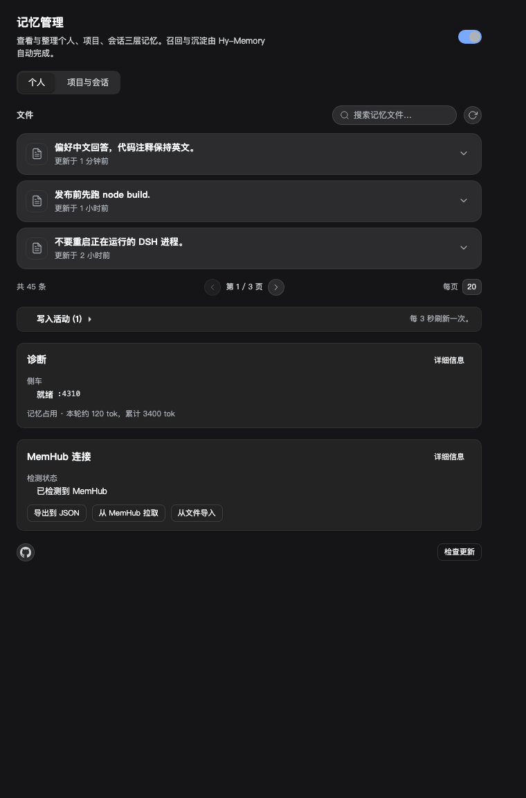
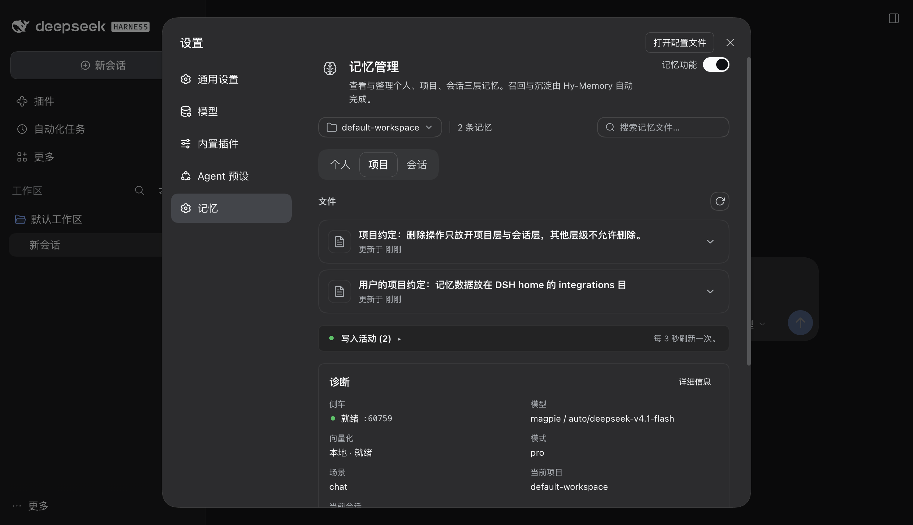
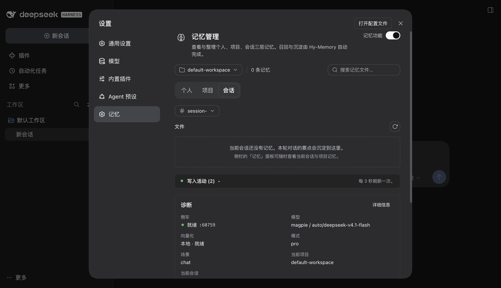

# hy-memory4dsh

Hy-Memory 2.0 as a native DSH memory component. Three tiers, three scenes, automatic recall before
each model step, automatic capture after each turn, and a manager panel under Settings > Memory.
No sidebar tab, no extra app, no configuration required for the default path.

```bash
dsh plugin --profile desktop add link:$(pwd)
```

Then open Settings > 记忆. The sidecar bootstraps its own Python environment on first use, and the
model route is read from your existing DSH provider settings.

**Keywords for store search:** `dsh-plugin`, `deepseek-harness`, `memory`, `agent-memory`,
`long-term-memory`, `hy-memory`, `memhub`, `three-tier-memory`, `personalization`, `context`.

## What it does

| Tier | Scope | Where it lives | Panel rights |
|---|---|---|---|
| Personal | the user, across every project | `user_id=dsh`, `agent_id=personal` | view, search, edit |
| Project | one workspace path | `agent_id=project:<sha1 of cwd>`, `session_id=project` | view, search, delete |
| Session | one DSH session inside its project | `agent_id=project:<key>`, `session_id=<session id>` | view, search, delete |

Tiers are not separate stores that fight each other. They are one Hy-Memory store with a three-level
namespace, so a memory written while working in a project can be promoted upward and recalled anywhere.
Recall runs one search per tier and merges them, so a session gets its own history, the project's
conventions and the user's long-term preferences in the same injected block.

Scenes follow Hy-Memory's own pipelines. A captured batch that contains file-editing tools is written
as `coding`, a batch with other tools as `working`, and a plain conversation as `chat`. Tool calls and
their results are part of the captured trajectory, not dropped.

## How a turn flows

1. `agent/pre-step`: the plugin searches all enabled tiers (personal, project, session), merges,
   deduplicates, caps the result by item count and characters, neutralizes any tag that could escape
   the injection frame, and appends one sourced user message. It has a hard deadline (1.2 s by
   default); a slow or broken sidecar skips injection instead of delaying the turn.
2. The turn runs normally. The six tools (`memory_search`, `memory_add`, `memory_list`, `memory_get`,
   `memory_update`, `memory_delete`) are available to the model.
3. `turn/end`: the plugin buffers the turn's user/assistant/tool events. Every N turns, or after an
   idle window, it writes the batch to the session tier with the detected scene.
4. Promotion: periodically, one LLM call classifies recent session memories and promotes the durable
   ones into the project tier and then the personal tier. Each promotion is recorded so it never repeats.

## Installation

```bash
node scripts/install.mjs --profile desktop     # uses the shipped dsh CLI: dependency + bundle selection
```

Then reload the DSH page (or restart the app) so the client half joins the plugin graph. Open
Settings > Memory.

The first start needs network once: the plugin creates a private Python 3.12 environment with
`hy-memory==2.0.13` (about 525 MB, via `uv` when available) and downloads an 80 MB local embedding
model. After that everything runs offline. Settings > Memory shows the state and offers a Start button,
so a cold install never blocks app startup.

## Configuration

Everything is optional. Open Settings > Memory for the panel; the defaults below are what a fresh
install uses.

| Field | Default | Meaning |
|---|---|---|
| `mode` | `pro` | `lite` writes embeddings only and needs no LLM; `pro` adds LLM extraction; `ultra` enables System 2 `evolve()` |
| `llm.source` | `dsh` | reuse the model this DSH profile already routes to (provider, base URL and key are read from `$DSH_HOME/settings.yaml` and `$DSH_HOME/.env`); `custom` overrides |
| `embedding.mode` | `local` | `local` runs ONNX MiniLM (384 dims) inside the sidecar; `remote` uses any OpenAI-compatible embeddings endpoint |
| `recall` | on, 5 items, 1600 chars, min score 0.32 | injection budget |
| `capture` | on, every 3 turns, idle flush 180 s, tools included | capture cadence |
| `promotion` | on, every 8 turns | session to project to personal promotion |
| `tiers` | all on | disable a whole tier |
| `enabled` | on | master switch; off pauses recall, capture and tools, and the panel becomes read-only |
| `ui.sessionPanel` | on | show the optional session-view pane |
| `sidecar.idleStopMs` | 30 min | stop the sidecar after inactivity |

`lite` mode is the no-model fallback: it needs no LLM key at all, only the local embedder.

## Hot reload while installed

The plugin is installed with `link:`, so editing this checkout and then touching the profile's
`cordis.patch.yml` recomposes the tree and reloads the plugin without restarting the app. A
`hy-memory` override row was appended to `~/.dsh/profiles/desktop/cordis.patch.yml` for exactly that
purpose; its only content is `enabled: true`, and removing the block returns the row to the bundle's
own patch. Browser code is separate: reload the page after a client rebuild.

## Embeddings

Recall needs vectors, so some embedder is always involved; which one is your choice.

| `embedding.mode` | What runs | Network | Notes |
|---|---|---|---|
| `local` (default) | chromadb's `all-MiniLM-L6-v2` ONNX, 384 dims | once, on first use | about 80 MB downloaded into `~/.cache/chroma/onnx_models`; already present here, then fully offline |
| `remote` | any OpenAI-compatible `/embeddings` endpoint | every call | set `baseURL`, `model`, `apiKey`, `dims`; a multilingual model fixes Chinese recall quality |
| disabled surfaces | lexical fallback only | none | semantic search is unavailable, but recall still returns token-overlap hits |

The local model is English-first, which is why a Chinese question can score below the cutoff; the plugin
falls back to a token-overlap scan in that case. Switching to a multilingual remote embedder removes the
need for that fallback. Nothing else in the plugin requires the ONNX model: capture, promotion, tiers and
the panel work without it, and a machine that never downloads it still gets lexical recall.

## Where data lives

```
$DSH_HOME/integrations/hy-memory/
  settings.json     your settings
  state.json        capture cursors, retry queue, project keys, promotion cursors
  boot.json         activation marker (pid, routes) written by the host half
  sidecar.log       sidecar stdout/stderr
  venv/             private Python environment
  data/             Hy-Memory store: Chroma vectors, Kuzu graph, SQLite history
```

Uninstalling the plugin leaves this directory alone. Delete it to remove all memory.

## How memories get their tier

`memory_add` no longer defaults everything to the personal tier. A small classifier reads the content:
repository facts, paths, commands, endpoints and conventions go to the project tier; preferences and
facts about the user stay personal; when both signals appear the project tier wins so the user profile
does not fill with technical noise; outside a project a project-tier write falls back to personal. Pass
`tier` explicitly to override, and the tool result states where the memory landed.

## Cross-project search

`memory_search` takes `allProjects: true` to search every project this user has touched instead of only
the current one. It fans out one scoped search per known project and merges the hits, each tagged with
its project key. Recall never does this implicitly: daily prompts only see the personal tier, the current
project and the current session, so another project's conventions cannot leak into unrelated work.

## Connecting to MemHub

Settings > Memory carries a MemHub card. MemHub is a separate product with its own store at
`~/.one-memory`; the card detects it read-only and offers three actions.

| Action | What happens |
|---|---|
| 导出到 JSON | pages this plugin's own store (all scenes) into `$DSH_HOME/integrations/hy-memory/exports/hy-memory-<ISO>.json` |
| 从 MemHub 拉取 | reads MemHub's store with a separate short-lived Python process (read-only, on a temporary copy), then writes every entry into the personal tier through this plugin's sidecar |
| 从文件导入 | same import from an absolute JSON path |

Import only ever writes the personal tier, dedupes by content hash persisted in `state.json`, and caps
at 500 entries per call. A MemHub runtime holding its store maps to `memhub_locked` with the holding
pid, so nothing is read while MemHub is writing. The dimension difference between the two stores does
not matter: only text crosses the boundary, and every imported entry is re-embedded locally.

## Coexistence with MemHub

MemHub (the separate local-first product) can be installed at the same time. It reaches DSH by scanning
`$DSH_HOME/sessions` and, if you enabled it there, by adding an MCP client row to a profile patch. This
plugin does not read or write MemHub's own store at `~/.one-memory`, and MemHub does not see this
plugin's store. If both are capturing the same conversations you will get two memories of the same
event, so pick one as the DSH path or keep MemHub for other apps only. The panel's diagnostics card
reports when `~/.one-memory` is present so the collision is visible instead of silent.

## Screenshots

Real captures from a running DSH instance (`docs/screenshots/`):





## Verifying it works

```bash
node --test 'test/**/*.test.mjs'     # host unit tests (pure logic)
node test/panel-smoke.mjs            # client bundle registers the right slots
cat "$DSH_HOME/integrations/hy-memory/boot.json"   # host half is live in the running app
```

The panel's diagnostics card shows sidecar state, the resolved model, embedding mode, and per-tier
counts. The activity list shows every recall, capture, promotion and error with timestamps.

## Limits worth knowing

- Working and coding memories live in separate Hy-Memory stores, and the SDK's HTTP surface does not
  forward `scene`, so the plugin reads them through its own bridge routes. A productivity memory is
  only reachable when it carries a `workspace_id`; with `capture.productivity: true` the plugin writes
  the git origin URL (or the repository path) as that id and recall searches with the same scope.
  Default capture routes every batch to the chat store and keeps the detected scene only as a label,
  because the chat store is searchable without extra scope.
- The bundled embedder is the English ONNX MiniLM (384 dims), so a Chinese query can score below the
  threshold against an English-stored memory. Recall therefore falls back to a token-overlap scan of
  recent memories when every semantic tier comes back empty. A remote multilingual embedder
  (`embedding.mode: remote`) removes the need for that fallback.
- The sidecar's own model calls run with thinking disabled. Gateway models that default to a thinking
  channel answer the reconcile prompt with an empty body, which the SDK reports as
  `RECONCILE_FAILED`; disabling thinking is what makes writes reliable.
- Editing is only allowed on personal memories; project and session memories can be deleted, as
  specified. Editing a productivity item is refused rather than silently written into the wrong store.
- Promotion is an LLM call. It runs at most once per window and is bounded by a timeout; a failure is
  recorded and retried next window rather than repeated per turn.
- A new session event type would break other readers, so the plugin never appends to the session log.

## Verified in a running app

- Three tiers hold real data (personal 4, project 11, session 67) and the panel reads all of them.
- Recall injects personal + current-project + current-session hits into a live turn.
- Capture kept a coding batch with 24 tool calls and wrote it through `/bridge/v1/add_scene`, so the coding store grew without touching chat.
- MemHub detection, export, pull (`memhub_locked` while MemHub runs) and import dedupe were exercised live.
- 85 host tests and the panel smoke suite pass; the plugin is installed with `dsh plugin --profile desktop add link:<dir>` and the running app serves its 14 routes.

Known gaps: the working scene is verified only in an isolated harness; the optional right-hand session pane has unit and smoke coverage but was not clicked in the real UI; a reconcile failure during a model outage falls back to the lite raw layer, and those rows do not show up in the pro lists until a later write settles them.
