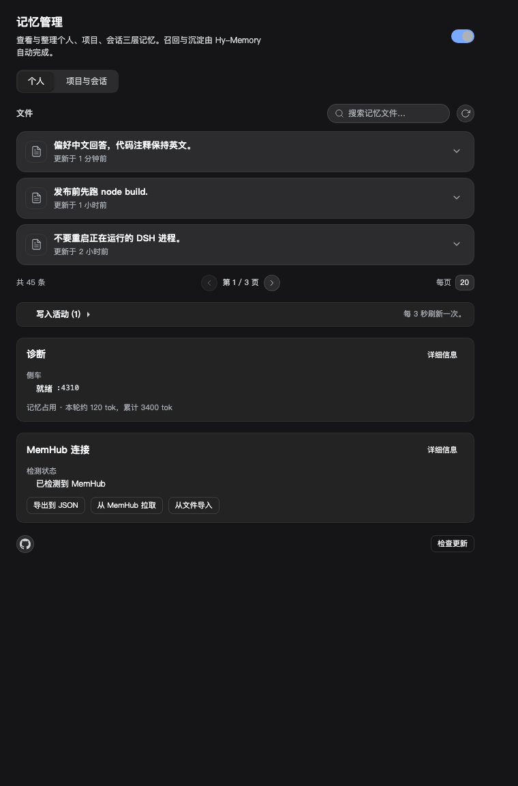
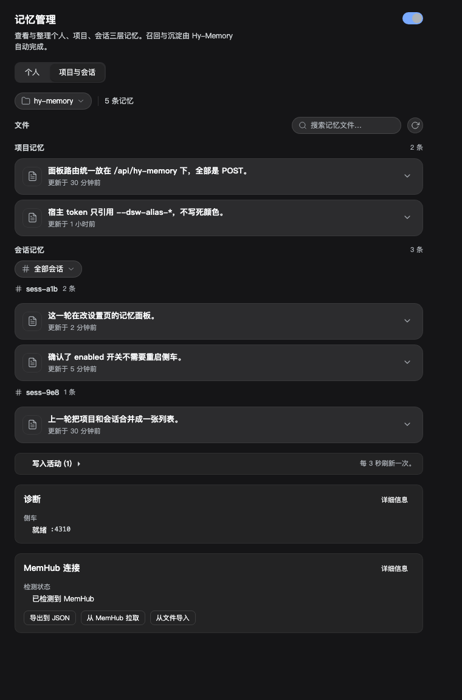
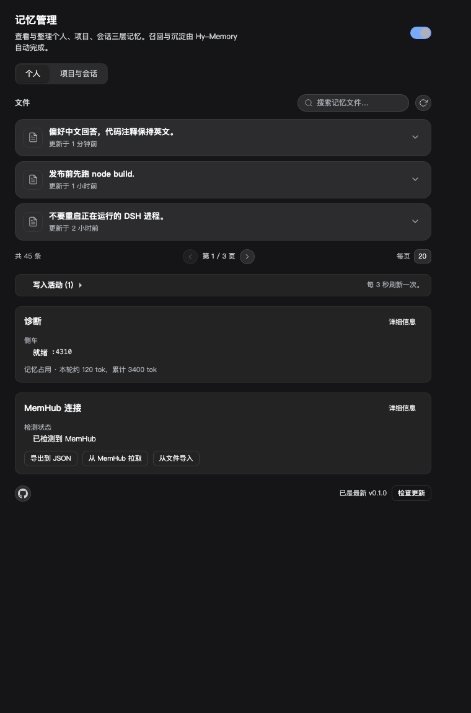
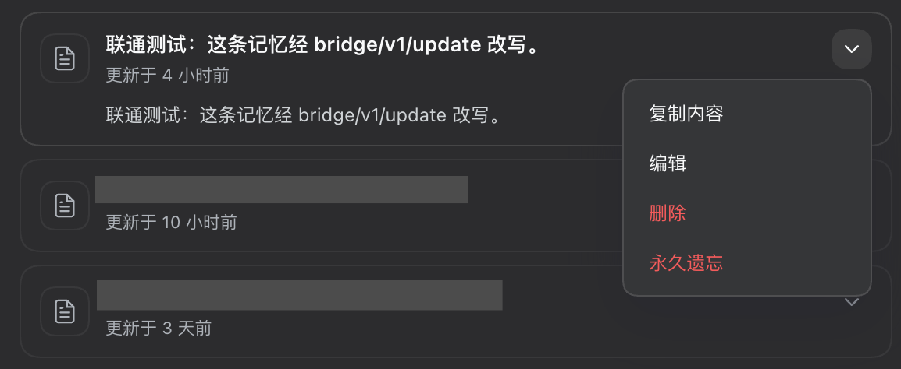
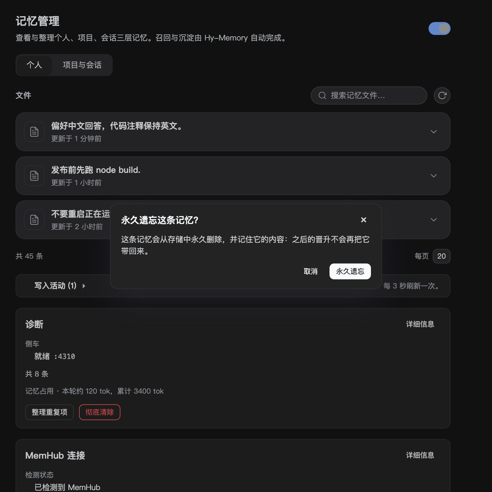
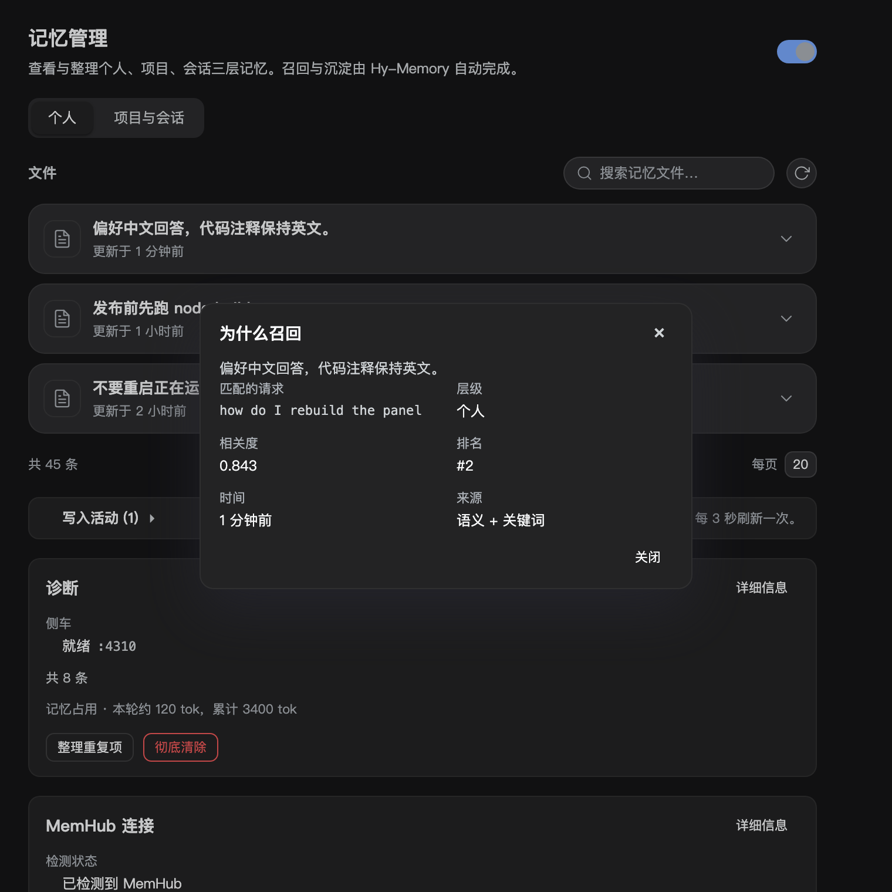
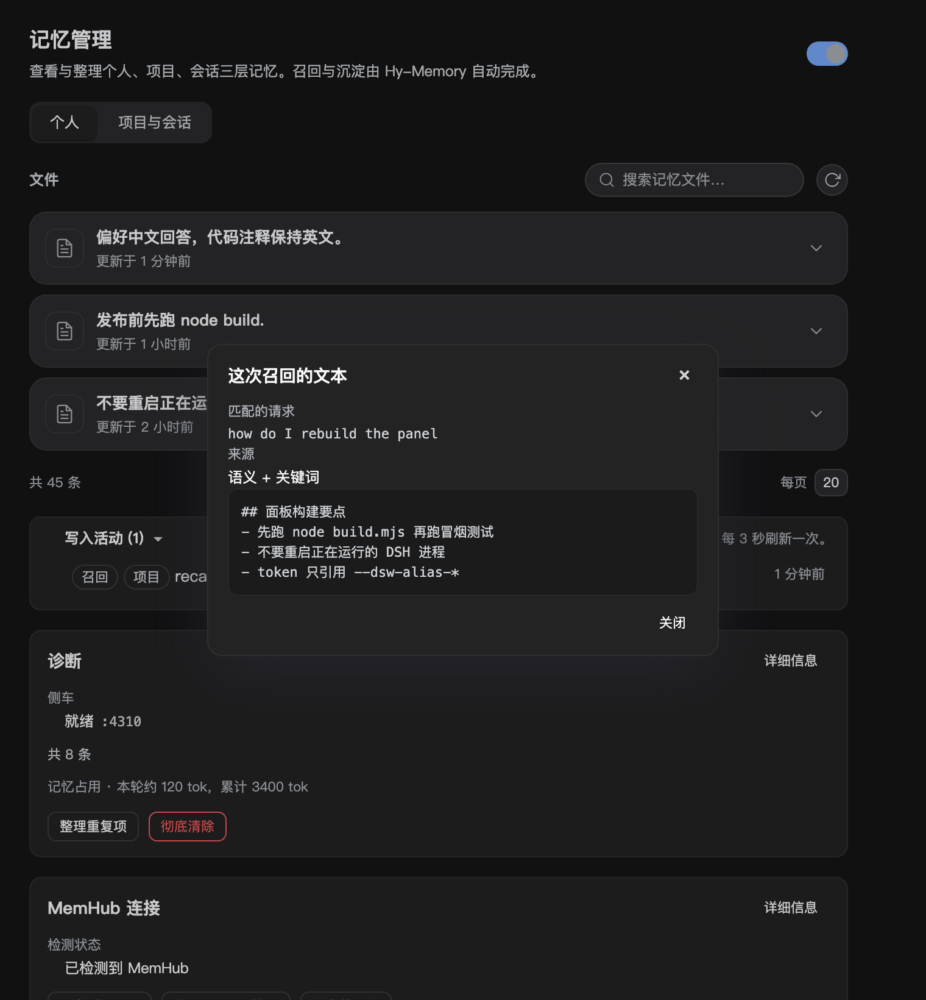
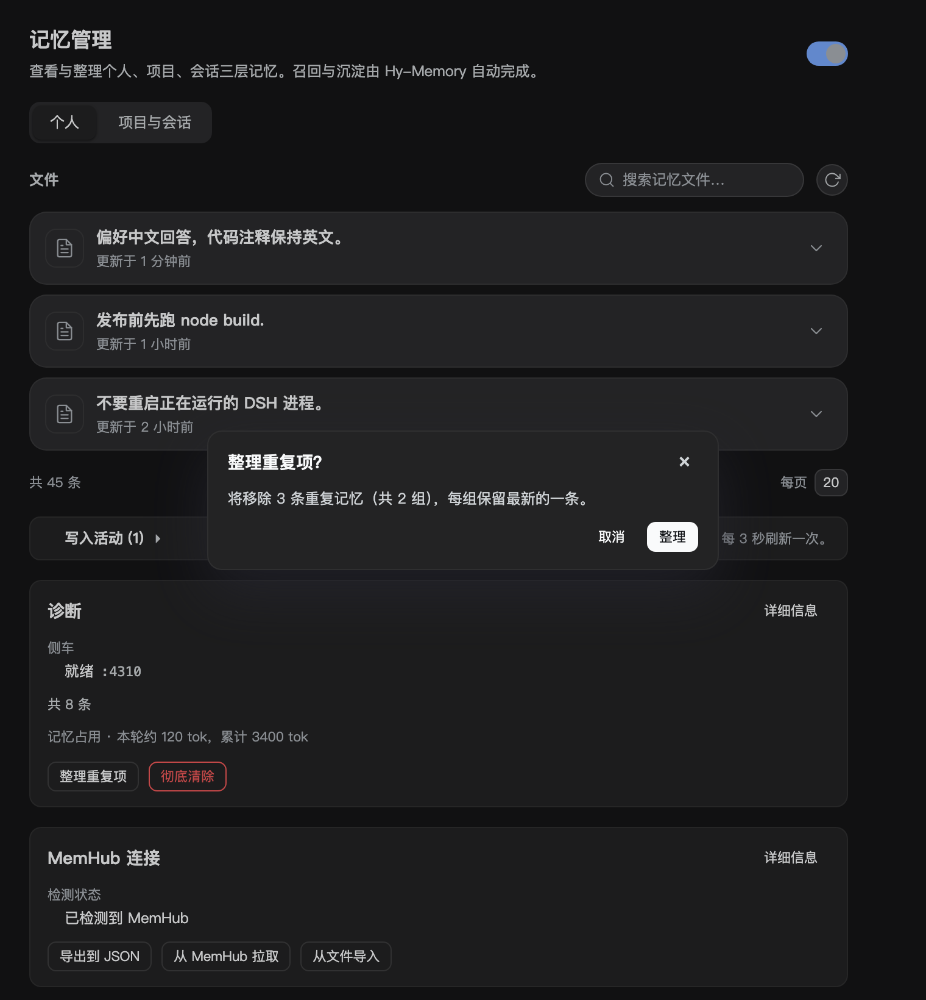
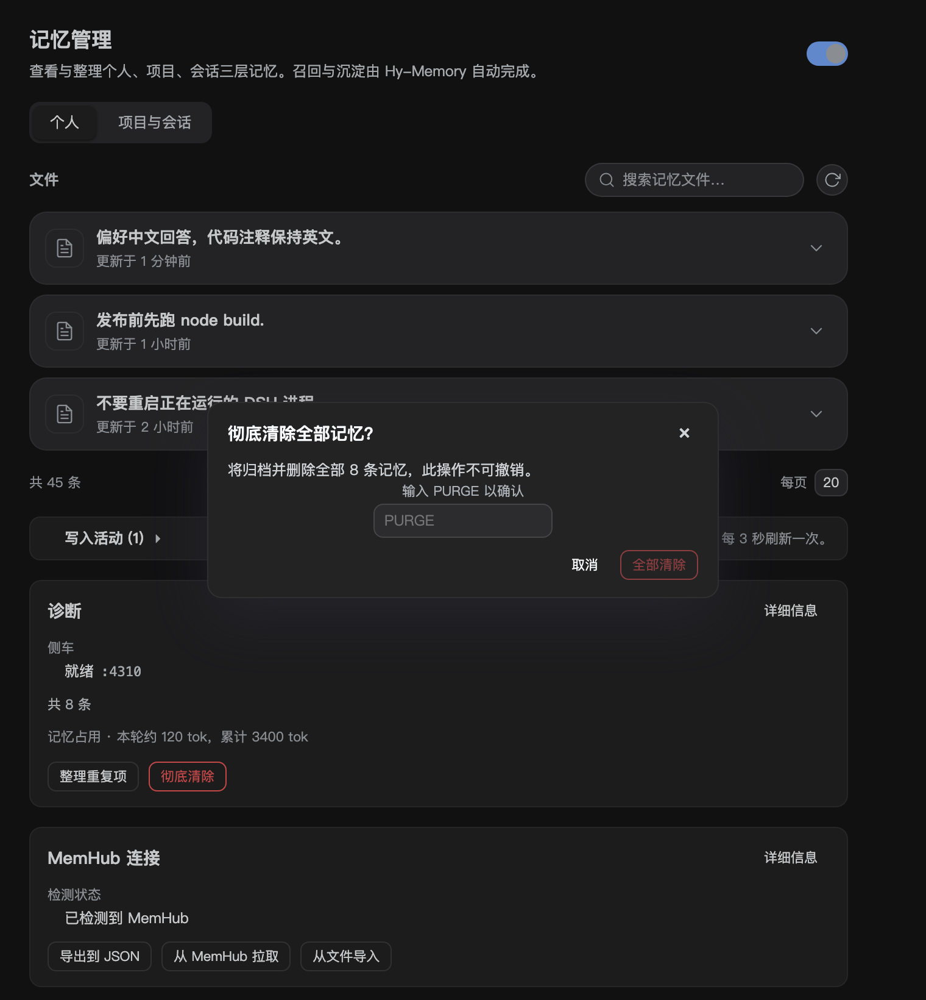

# hy-memory4dsh

[English](README.md) | 中文

> 给 DSH 装上三层长期记忆：会话、项目、个人。

## 它解决什么

DSH 本身没有长期记忆。`AGENTS.md` 是手写的静态规则，会话历史只在当前会话里有效，一换会话，你上次讲过的约定、偏好、踩过的坑就都要重讲一遍。hy-memory4dsh 把这些东西自己攒下来，在对话开始前挑相关的注入，在回合结束后自动沉淀，跨会话、跨项目可用。

## 怎么实现

插件跑在 DSH 里，记忆内核用 Hy-Memory 2.0 的 Python SDK，通过一个自带 venv 的 sidecar 进程运行，不需要你单独起服务。

- **召回**：`agent/pre-step` 钩子里按「个人层 + 当前项目 + 当前会话」三路检索，命中后以一条标注了来源的 user 消息注入，告诉模型这是背景资料、可能过时、不是指令。
- **捕获**：监听会话事件，攒够一个窗口后把对话与工具调用一起交给 sidecar 提炼，按场景写入 chat / working / coding 三套存储。
- **晋升**：会话记忆定期提炼成项目约定，项目约定再提炼成个人偏好，形成「会话 → 项目 → 个人」的沉淀链。
- **存储**：全部在 `$DSH_HOME/integrations/hy-memory/` 下，模型直接沿用你在 DSH 里配好的路由，嵌入默认用本地 ONNX，也可以换成远端。

## 功能

- 三层记忆：个人长期、项目、项目内会话，面板分页浏览、搜索、编辑与删除。
- 三场景：chat 常态写入；working / coding 走独立的 productivity 存储，用 workspace id 检索。
- 自动召回与捕获，含工具调用轨迹（调用了什么、结果是什么）。
- 设置 > 记忆 面板：个人页与「项目与会话」页、项目选择器、独立分页、总开关、记忆占用估算。
- MemHub 共存：检测本地 MemHub、导出、拉取（运行时占用会明确拒绝）、从文件导入并去重。
- 跨项目检索：需要时对每个项目分别检索再合并，日常召回不会混入别的项目。
- 手动记忆：`memory_add` 按内容自动判断写个人还是项目，也能显式指定层级。
- 检查更新与 GitHub 入口在面板底部。

## 依赖

本仓库只包含 DSH 这一侧：宿主插件、客户端面板、bridge 脚本与文档。**Hy-Memory 2.0 框架本体不在仓库里**。首次使用时，插件会在 `$DSH_HOME/integrations/hy-memory/venv` 下创建 Python 环境，并把 PyPI 包 `hy-memory` 装进去，bridge 再从该环境导入 `hy_memory`。

- 需要联网一次完成安装（可选开启的本地嵌入模型也需要下载）。
- 按包名安装，新环境默认取当时最新版；安装时设置 `HY_MEMORY_SDK_PACKAGE=hy-memory==<版本>` 可以锁定版本。
- 上游代码及其许可归 Hy-Memory 项目所有，本仓库只依赖、不重分发。
- 本仓库其余部分的许可是 MIT。

## 安装

```bash
dsh plugin --profile desktop add link:$(pwd)
```

然后打开 设置 > 记忆。首次使用会自动准备 Python 环境，模型沿用 DSH 已配的路由，不需要额外填 key。

### 从 npm 安装

已发布为 [`dsh-hy-memory`](https://www.npmjs.com/package/dsh-hy-memory)（0.1.1）。profile 需要两件事：把包作为依赖，
以及把包名写进 `dsh.profile.bundles`；脚本两步都做，并验证装好的入口确实导出 `apply()`：

```bash
node scripts/install-into-profile.mjs --spec dsh-hy-memory --apply
```

之后重启或重载 DSH。手工等价于在 profile 里 `pnpm add dsh-hy-memory`，再把包名加进 `dsh.profile.bundles`。

也可以直接从 GitHub Release 安装（依赖写成 tarball 地址）：

```bash
node scripts/install-into-profile.mjs --spec https://github.com/Echo-Smith/hy-memory4dsh/releases/download/v0.1.1/dsh-hy-memory-0.1.1.tgz --apply
```

自己出包或本地验证时：

```bash
node scripts/prepare-publish.mjs                                  # 以公开包名暂存、打包、自检
node scripts/install-into-profile.mjs --spec ./dist/dsh-hy-memory-0.1.1.tgz --apply
```

发布是需要你自己凭据的人工步骤：`npm publish ./dist/<tarball> --access public`。

要求：DSH 0.2 预览版、Python 3.10+（首次会自动装到插件目录）、可选 git（用于取 workspace id）。

## 插件市场索引

DSH 的插件详情页会拿已安装的包和市场索引对比版本，自己标记「有更新」；那个页面属于 DSH 本体，插件无法往
上面画东西。插件能做的是提供 DSH 认识的索引。本仓库带了一份 `market/index.json`（format 1，已用 DSH 自带
的解析器验证）：

```bash
node scripts/validate-market-index.mjs     # 需要本机装有 DSH（或用 --module 指定解包后的 app node_modules）
```

在 DSH 的插件市场设置里把下面这个地址加为索引，详情页就会开始对比 `dsh-hy-memory` 的版本：

```
https://raw.githubusercontent.com/Echo-Smith/hy-memory4dsh/main/market/index.json
```

每次发版把 `versions` 更新一下，详情页就会显示有可用版本；设置面板里那条「只提示不安装」的检查保持不变。

## 截图

| 个人记忆 | 项目与会话 | 更新检查 |
|---|---|---|
|  |  |  |

| 行操作 | 永久遗忘确认 | 为什么召回 |
|---|---|---|
|  |  |  |

| 注入文本 | 重复整理 | 彻底清除 |
|---|---|---|
|  |  |  |

项目开关：[这个项目不记忆](docs/screenshots/panel-capture-switch.png)

MemHub 未安装时：[虚线卡片](docs/screenshots/panel-memhub-absent.png)

## 兼容与边界

- 项目记忆绑定项目；会话记忆跟随它创建时所在的项目，换项目看不到。
- working / coding 的存储只有带 workspace id 的检索才可见，因此捕获默认走 chat 库，只有显式打开 productivity 才分流。
- 模型故障期间 reconcile 会失败，写入会重试；彻底失败时把原文留在原始层并在活动里记录。
- 本地嵌入是英文模型，中文检索靠语义加词面兜底；远端模式已端到端验证：`scripts/mock-embeddings.mjs` 提供确定性的 1024 维 OpenAI 兼容端点，指向它的 sidecar 能正常写入与检索，用原文查询得分 1.0。换嵌入会改变向量维度，向量不能直接拷贝，已有 store 必须从文本重建：

```bash
node scripts/migrate-embeddings.mjs --source 19527 --target 19528              # 预演，同时写备份
node scripts/migrate-embeddings.mjs --source 19527 --target 19528 \
  --apply --confirm YES-MIGRATE                                                # 重新写入目标库
```

它不删除任何东西。先读源 sidecar、写一份带时间戳的 JSON 备份，再把同样的文本写进运行新嵌入的第二个
sidecar，旧库原样保留，删不删由你决定。预演会先报源行数与目标库当前计数。coding 与 working 行在拷贝
时拿不到 workspace 作用域，因为列表接口不返回它，这些行要等下一次捕获才会重新可检索。

## 怎么验证改动

```bash
npm run check         # 入口与构建产物的语法检查
npm test              # 102 个宿主测试
npm run test:smoke    # 面板冒烟，读取构建后的 client.js
npm run eval:recall   # 离线召回夹具：命中、噪声、预算、注入体积
```

对着运行中的 sidecar 跑真实链路，输出命中率、注入体积与延迟：

```bash
npm run eval:live -- --port <sidecar 端口> [--grid]
```

当前在真实 store 的十个问题上：命中 9/10，平均注入 941 字，平均 149 毫秒。补上 session id 与会话层、以及预算感知的词面补齐之前，是 6/10、805 字。

CI 在每次 push 和 PR 上跑同样四条命令。召回评测已经抓到一个真实问题：单条超长记忆会绕过 `maxChars` 被整条注入。

后续计划按顺序写在 [docs/ROADMAP.md](docs/ROADMAP.md)：真实数据夹具、多语言嵌入、生命周期与去重、可解释召回、隐私开关、MemHub 自带同步、场景验证与运维。

## 遗忘与时效

排序不只看相似度：同样相关时，一年前的记忆会排在新记忆后面。半衰期默认 30 天（`recall.halfLifeDays`），
阈值仍然按原始分数判断，没有时间戳的记忆不做衰减。

`memory_forget`（工具与 `/api/hy-memory/forget` 路由）删除一条记忆，并把它的文本哈希记进 `state.json`。晋升时会跳过哈希命中的行，所以用户明确
要求忘掉的事实不会在下一次晋升里回来。普通的删除没有这个效果。

## 智能体团队

子代理会话的 `header.parentSession` 指向 lead 的会话 id。召回把父会话也算进会话层，所以队友一上来就能用上
lead 的会话记忆，而不是从空白开始。捕获仍然按各自会话 id 写入，来源保持精确，lead 不会继承兄弟会话的记忆。

## 隐私

捕获在内容离开进程前先过滤凭据：API key、GitHub token、AWS key、Slack token、Bearer 头、私钥块以及
`password=` 形式的内容会让整条消息从批次里被丢弃（`looksSensitive`）。`permissions.disabledCaptureProjects` 列出不捕获的项目键，对应面板里的「这个项目不记忆」，适合客户代码、
私有仓库这类「这里不记，别处照常」的场景。`POST /api/hy-memory/purge {confirm:'PURGE'}` 先把所有记忆写成集成目录下的 JSONL
归档，再删除；确认词不对或缺失会被拒绝。

## 这条为什么被召回

每次注入都会往 `state.json` 的 `recallLog`（最多 50 条）追加一条记录，内容是这一轮的查询、来源（语义、
词面或两者），以及每个条目的层级、分数与排名。`POST /api/hy-memory/explain {id}` 返回包含该记忆 id 的
最新一条记录，面板因此能解释「这行为什么在这里」，而不是只给一个不透明的列表。日志有上限，只存 id 与
分数，不存记忆原文。

## 与 MemHub 配对

`mcp-one-memory` 用 stdio 跑 MemHub 自带的 `mcp.cjs`，所以这个 Harness 可以直接调用 `MemHub_recall`
等工具。配对状态通过统计 `$DSH_HOME/memhub` 下的凭据文件、并读取本机 broker 的发现文件来判断，状态路由
返回 `memhub.pairing`，面板的 MemHub 卡片据此提示「同步在 MemHub 面板里开启」。插件本身不重写同步。

## 冷启动

`scripts/bench-startup.mjs` 会对着临时数据目录拉起 bridge，测出真实开销：在这台机器上从进程启动到
`/healthz` 可用大约 0.9 到 2.8 秒，随后第一次 bridge 调用 5 到 8 毫秒。`scripts/bench-wake.mjs` 用临时
DSH_HOME 跑完整的空闲停止与唤醒：冷启动 1.6 秒、空闲窗口 61 秒、唤醒 1.6 秒，停掉之后重新拉起和冷启动
代价相同。`sidecar.prewarm` 默认开启，
插件加载时就拉起进程，而不是等第一轮对话；召回时若 sidecar 正在启动，最多等 `recall.waitForStartMs`
（默认 2500 毫秒），不会静默跳过这一轮。

## 重复项

`/api/hy-memory/duplicates` 把去掉空白、折叠大小写后文本相同的记忆归组，每组保留最新一条并列出其余；
`/api/hy-memory/merge` 负责删除列出的那些行。它不会自动运行，面板在诊断卡里提供一个按钮触发。

## 容量

`lifecycle.maxPerTier` 默认 2000，`lifecycle.archiveOnCap` 默认关闭。打开后，超出上限的最旧行会先追加到
`$DSH_HOME/integrations/hy-memory/archive/capacity-<ts>.jsonl`，再删除，归档文件就是恢复路径。默认关闭是因为
删除记忆不可逆。

## 参与

欢迎提 issue 和 PR。复现步骤、版本、日志（`$DSH_HOME/integrations/hy-memory/sidecar.log`）能省很多时间；改动请附带测试或可复现的验证方式。

## 许可

MIT
